---

## Work

| | Project | What it does | Where |
|---|---|---|---|
| 🧠 | **[KnowFlow](https://github.com/tornidomaroc-web/knowflow)** | Arabic-first study app: upload course files, ask questions, get answers that name the source file, plus summaries and quizzes | [App Store](https://apps.apple.com/us/app/knowflow-study-your-notes/id6820418649?uo=4) · [Web](https://tryknowflow.com) |
| 🏠 | **Daftar Alwaseet** | Offline Arabic app for Saudi real-estate brokers: turns a client's WhatsApp message into a saved client with a follow-up reminder. No server, no account | [App Store](https://apps.apple.com/sa/app/daftar-alwaseet-broker-crm/id6822930243?uo=4) |
| 📄 | **[Scan & Action](https://github.com/tornidomaroc-web/scan-and-action)** | Receipt and invoice processing in English, French and Arabic: Gemini reads the receipt, a rule engine flags what needs a second look | [Google Play](https://play.google.com/store/apps/details?id=com.scanaction.app&hl=en) · [Web](https://www.scan-action.com) |
| 🦄 | **[UnicornApps](https://github.com/tornidomaroc-web/UnicornApps)** | Product copy from one photo — title, description, bullets, Shopify HTML, social captions — in Arabic or English | [Google Play](https://play.google.com/store/apps/details?id=com.unicornappsai.app&hl=en) · [Web](https://www.unicornapps.app) |
| 🔧 | **[Fixor](https://github.com/tornidomaroc-web/fixor)** | Open-source pull-request security scanner for Node/TypeScript, with its measurements published in the repo, including a negative result | Open source |

---

## Stack

`TypeScript` · `Python` · `Next.js` · `React Native / Expo` · `FastAPI` · `Supabase` · `PostgreSQL` · `Prisma` · `Claude API` · `Gemini` · `Capacitor` · `Railway` · `Vercel` · `Paddle`

---

Built end to end by one developer, from Morocco.

---
