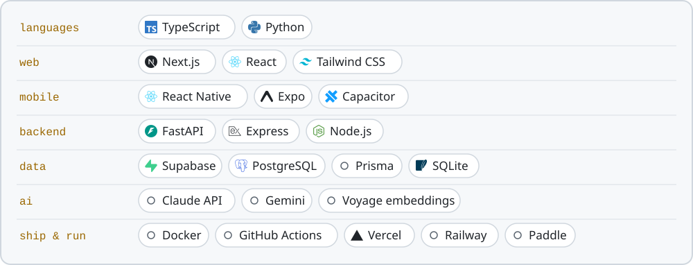

<p align="center">
  <picture>
    <source media="(prefers-color-scheme: dark)" srcset="assets/header-dark.svg">
    
  </picture>
</p>

<p align="center">
  <a href="https://www.linkedin.com/in/abojad"></a>&nbsp;
  <a href="https://portfolio-three-lac-35.vercel.app"></a>
</p>

## `whoami`

I build products end to end, from the database to the store listing, and ship them to the **App Store**, **Google Play** and the web. Most of my work is Arabic-first, in Arabic, English and French, with AI where it does real work: answers grounded in a student's own files, receipts read into structured data, product copy from one photo.

```text
abdelfettah@morocco:~$ focus
├── apps     → App Store · Google Play · web
├── ai       → Claude · Gemini · RAG
├── backend  → FastAPI · Express · Supabase
├── arabic   → RTL · Arabic · English · French
└── habits   → tests · CI · written limits
```

## Featured work

| Project | What it demonstrates | Focus | Status |
|---|---|---|---|
| **[UAS Sustainment Workbench](https://github.com/tornidomaroc-web/uas-sustainment-workbench)** | Reads PX4 and ArduPilot flight logs and keeps a civil drone fleet's maintenance records: what is due, and why | Python · FastAPI · SQLite | Open source · [Demo](https://tornidomaroc-web.github.io/uas-sustainment-workbench/) |
| **[KnowFlow](https://github.com/tornidomaroc-web/knowflow)** | Arabic-first study app: answers from your own course files that name the source | Next.js · FastAPI · Claude | [App Store](https://apps.apple.com/us/app/knowflow-study-your-notes/id6820418649?uo=4) · [Web](https://tryknowflow.com) |
| **[Scan & Action](https://github.com/tornidomaroc-web/scan-and-action)** | Receipts and invoices in EN, FR and AR: Gemini reads them, rules flag what needs review | React · Express · Prisma | [Google Play](https://play.google.com/store/apps/details?id=com.scanaction.app&hl=en) · [Web](https://www.scan-action.com) |
| **[UnicornApps](https://github.com/tornidomaroc-web/UnicornApps)** | Product copy from one photo, in Arabic or English, with credits and Paddle billing | Next.js · Supabase · Gemini | [Google Play](https://play.google.com/store/apps/details?id=com.unicornappsai.app&hl=en) · [Web](https://www.unicornapps.app) |

**Measured, with the source in each repo**

- **Workbench:** analysed 40 PX4 and 10 ALFA public flight logs, and reports 355 s of flight that no log covers (`results/`, `LIMITS.md`).
- **KnowFlow:** iOS signed-in test run passed 48 of 48; approved on the App Store five days after a rejection (`docs/PROGRESS.md`).
- **Scan & Action:** a model change checked against 10 fixture receipts, reproduced with 0 errors (`modelArm.ts`).
- **UnicornApps:** Android bundle cut from 57.53 MB to 4.78 MB (`RESUME_PLAY_PUBLISH.md`).

## Stack

<picture>
  <source media="(prefers-color-scheme: dark)" srcset="assets/stack-dark.svg">
  
</picture>

## Current direction

```text
[ BUILD ] → [ SHIP ] → [ MEASURE ]
```

Looking for a full-time **AI engineer** role, on-site or remote, in Morocco or the Gulf: shipping mobile and web products with AI features, Arabic-first.

---

<div align="center">

### Let's connect

**Morocco** · [LinkedIn](https://www.linkedin.com/in/abojad) · [Portfolio](https://portfolio-three-lac-35.vercel.app)

`Build it. Ship it. Measure it.`

</div>
