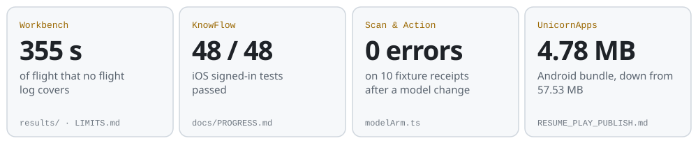

<picture>
  <source media="(max-width: 700px) and (prefers-color-scheme: dark)" srcset="assets/header-dark-narrow.svg">
  <source media="(max-width: 700px)" srcset="assets/header-light-narrow.svg">
  <source media="(prefers-color-scheme: dark)" srcset="assets/header-dark.svg">
  
</picture>

<p align="center">
  <a href="https://www.linkedin.com/in/abojad"></a>&nbsp;
  <a href="https://portfolio-three-lac-35.vercel.app"></a>
</p>

## `whoami`

I build products end to end, from the database to the store listing, and ship them to the **App Store**, **Google Play** and the web.

Most of my work is **Arabic-first**, in Arabic, English and French, with AI where it does real work: answers grounded in a student's own files, receipts read into structured data, product copy from one photo.

```text
abdelfettah@morocco:~$ focus
├── apps     → App Store · Google Play · web
├── ai       → Claude · Gemini · RAG
├── backend  → FastAPI · Express · Supabase
├── arabic   → RTL · Arabic · English · French
└── habits   → tests · CI · written limits
```

## Featured work

| Project | Status | What it demonstrates | Focus |
|---|---|---|---|
| **[UAS Sustainment Workbench](https://github.com/tornidomaroc-web/uas-sustainment-workbench)** | Open source · [Demo](https://tornidomaroc-web.github.io/uas-sustainment-workbench/) | Reads PX4 and ArduPilot flight logs and keeps a civil drone fleet's maintenance records: what is due, and why | Python · FastAPI · SQLite |
| **[KnowFlow](https://github.com/tornidomaroc-web/knowflow)** | [App Store](https://apps.apple.com/us/app/knowflow-study-your-notes/id6820418649?uo=4) · [Web](https://tryknowflow.com) | Arabic-first study app: answers from your own course files that name the source | Next.js · FastAPI · Claude |
| **[Scan & Action](https://github.com/tornidomaroc-web/scan-and-action)** | [Google Play](https://play.google.com/store/apps/details?id=com.scanaction.app&hl=en) · [Web](https://www.scan-action.com) | Receipts and invoices in EN, FR and AR: Gemini reads them, rules flag what needs review | React · Express · Prisma |
| **[UnicornApps](https://github.com/tornidomaroc-web/UnicornApps)** | [Google Play](https://play.google.com/store/apps/details?id=com.unicornappsai.app&hl=en) · [Web](https://www.unicornapps.app) | Product copy from one photo, in Arabic or English, with credits and Paddle billing | Next.js · Supabase · Gemini |

## Measured

<picture>
  <source media="(max-width: 700px) and (prefers-color-scheme: dark)" srcset="assets/metrics-dark-narrow.svg">
  <source media="(max-width: 700px)" srcset="assets/metrics-light-narrow.svg">
  <source media="(prefers-color-scheme: dark)" srcset="assets/metrics-dark.svg">
  
</picture>

<sub>Each card names the file in that repo where the number comes from. The Workbench figure comes from 40 PX4 and 10 ALFA public flight logs.</sub>

## Stack

<picture>
  <source media="(max-width: 700px) and (prefers-color-scheme: dark)" srcset="assets/stack-dark-narrow.svg">
  <source media="(max-width: 700px)" srcset="assets/stack-light-narrow.svg">
  <source media="(prefers-color-scheme: dark)" srcset="assets/stack-dark.svg">
  
</picture>

## Current direction

```text
[ BUILD ] → [ SHIP ] → [ MEASURE ]
```

Looking for a full-time **AI engineer** role, on-site or remote, in Morocco or the Gulf: shipping mobile and web products with AI features, Arabic-first.

---

<div align="center">

### Let's connect

<a href="https://www.linkedin.com/in/abojad"></a>&nbsp;
<a href="https://portfolio-three-lac-35.vercel.app"></a>

**Morocco** · Arabic · English · French

`Build it. Ship it. Measure it.`

</div>
